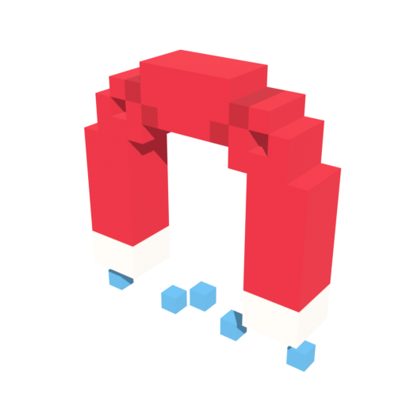

# Throw a Magnet 🧲🏜️

**Jeu Roblox mobile-first au style voxel, dans un Grand Canyon façon Far West.**
On lance un aimant au fond du canyon, on remonte une relique couverte de boue, on la nettoie, on découvre sa rareté… puis on la **vend** ou on l'**expose dans son musée** pour gagner un revenu passif.

> Projet personnel : design, code (Luau), modèles 3D (Blender + Python) et interface.

---

## 🎮 Boucle de jeu

1. **S'entraîner** au banc de musculation pour gagner de la puissance de lancer.
2. **Lancer l'aimant** avec une jauge de timing : plus la puissance est haute, plus on descend profond, vers des zones plus riches.
3. **Remonter la relique**, avec des animations de descente et de remontée qui s'intensifient selon la rareté (ondes de choc, faisceau de lumière, ralenti).
4. **Nettoyer** la relique (appui maintenu), puis **révélation** animée parmi 8 raretés, de *Commun* à *Secret* (0,1 %).
5. **Vendre** pour améliorer son équipement, ou **exposer** dans l'un des 6 musées (12 vitrines chacun) pour un revenu passif.

## 🧠 Ce que le projet montre

- **Économie de jeu et engagement** : progression par zones, probabilités par rareté, multiplicateurs, boutique d'améliorations, revenu passif. Tous les réglages sont centralisés dans un seul module (`Config.lua`).
- **Architecture client / serveur** : le serveur fait autorité sur l'argent, les tirages et les musées, ce qui empêche la triche côté client. La communication passe par des RemoteEvents.
- **Sauvegarde fiable** : DataStore avec réessais, et un mode mémoire si le service est indisponible.
- **Génération procédurale du décor** : canyon voxel construit à partir d'une carte de hauteur, strates par altitude, faces cachées supprimées et pièces fusionnées (environ 1 350 pièces seulement), rivière, cascade et lumière de coucher de soleil.
- **Pipeline 3D automatisé** : plus de **1 000 reliques** et des dizaines de décors générés en voxels par des scripts **Python dans Blender**, exportés en FBX puis envoyés sur Roblox par l'API **Open Cloud**.
- **Game feel** : interface style « simulateur » (boutons animés et sonores, confettis, pièces, vitrines 3D), ambiance animée (condors, virevoltants, tourbillons de poussière) et caméra cinématique.

## 🗂️ Organisation du code

| Dossier | Contenu |
|---|---|
| `ThrowARelic/ReplicatedStorage/Modules/` | `Config` (toutes les valeurs du jeu) et `RelicCatalog` (catalogue des reliques) |
| `ThrowARelic/ServerScriptService/` | `GameServer` (logique serveur), `SaveService`, `BenchService`, `WorldBuilder`, `Landscape` |
| `ThrowARelic/StarterPlayerScripts/` | `ClientController` (UI, jauge, caméra, animations), `UIKit` (composants d'interface), `AmbienceController` |
| `tools/` | Scripts Python Blender (génération voxel) et scripts Luau d'installation dans Studio |
| `Assets/` | Modèles FBX, rendus et catalogue des reliques |

**Environ 10 000 lignes de Luau et 2 300 lignes de Python.**

## 🛠️ Technologies

Roblox Studio · Luau (typé) · DataStoreService · Blender + Python (bpy) · Roblox Open Cloud API

---
Projet personnel de [Jules](https://julioo28.github.io).
